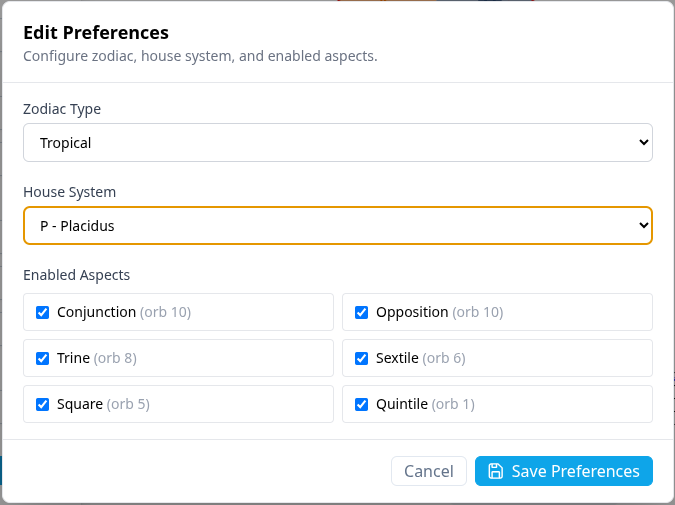

## Chart display prefrences

You can toggle the display of various chart details by using the Edit/Prefrences menu

## Zodiac Type

You can choose the followng zodiac types for your charts

- Placidus
- Tropical

### House systems

There are many house systems

### Aspects

You can toggle the visibility of the following aspects

- Oppositions
- Conjunctions
- Squares
- Trines
- Semisquares
- Quintiles
